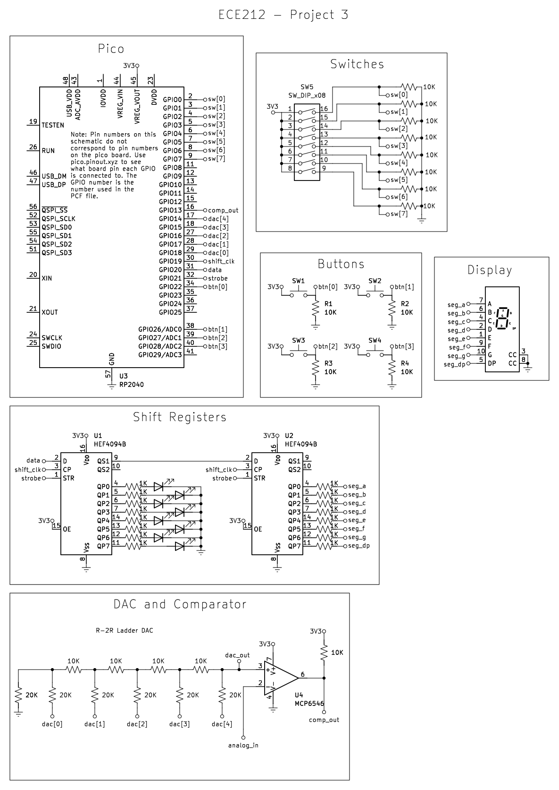
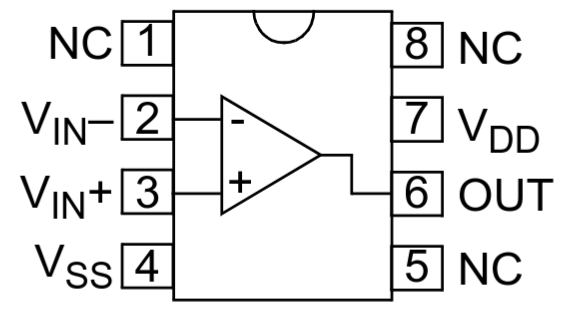
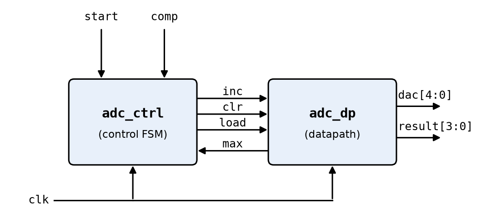
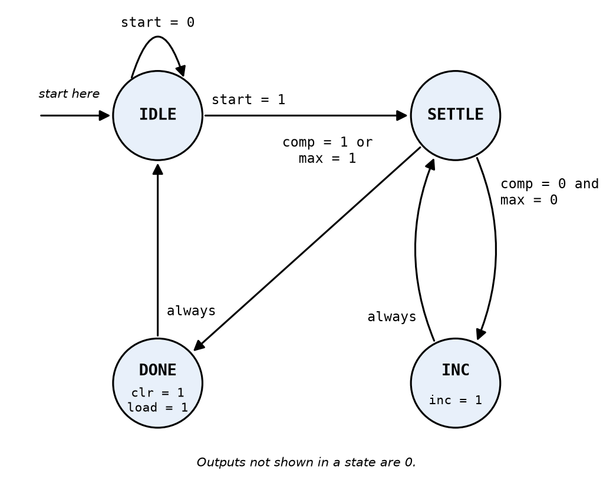

# ECE 212 Project 3 - Analog Recorder - Fall 2026

## Before You Start

Download this repository by opening a terminal or PowerShell, navigating to the directory where you want to put this repository, and then running:
```
git clone https://github.com/DougTownsend/ece212-project3.git
```

## Background

So far, everything we have done in this course has been purely digital. We interpret signals as either zeros or ones, and operate on them using Boolean algebra. While this is useful for implementing complex logic, we sometimes need to interact with a device that has an analog input or output. An analog signal is a signal where we care about the voltage value, rather than just whether it is above or below some threshold. Sensors typically take analog measurements, and then either output that analog voltage, or have a built-in analog to digital converter to provide a digital output. Examples include microphones, temperature sensors, and potentiometers. Other devices take an analog signal as an input, such as speakers. To use these devices, we need a way of converting back and forth between analog and digital signals.

In this project, you will build a digital to analog converter (DAC) out of resistors, and then use it along with a comparator to build an analog to digital converter (ADC). You will then use them to make a recorder that can record a slowly changing analog signal into one of four memory banks, and play it back on the DAC.

## Provided Files and Autograding

This repository contains the directories `pico_recorder` and `fpga_recorder`. You will do your work in the directory that corresponds to the board you are using. Inside each directory there is a `test` directory, which contains all of the testbenches that the autograder will run. To run the tests, **your terminal must be in the `pico_recorder` or `fpga_recorder` directory** and then run:
```
apio sim test/<name_of_testbench>.v
```
Replace `<name_of_testbench>` with the testbench filename you want to run.

When you run a simulation, it will produce a text file that the autograder will compare against the text file produced by the solution. I have provided the solution outputs so you can check your code without waiting for the autograder to complete. Each `test` directory has a `results` subdirectory. This contains the outputs that the autograder compares against, named something like `test_1_0_led_bar_soln.txt`. When you run the testbench, it will produce a file in the `results` directory named something like `test_1_0_led_bar.txt`. If the `*.txt` file matches the `*_soln.txt` file, your module passes that test. A Python script `test.py` will run all tests that the autograder runs, and print the results. To run the script, with a terminal in the `*_recorder` directory, run `python3 test.py` on Mac and Linux, or `python test.py` on Windows. To run only the tests for one module, add the module's name, like `python3 test.py recorder`.

You will submit the following files to Gradescope:
```
main.v
led_bar.v
tick.v
adc_dp.v
adc_ctrl.v
adc.v
memory.v
recorder.v
```
To receive full credit, you must submit all files at the same time. However, every test except the `main.v` tests checks a single file, so you can submit them individually if you don't want to run the testbenches on your own. The tests for `main.v` require all the files.

**All the files you will modify have comments that say "Do not modify above this line"**. However, it is okay for you to change a `reg` to a `wire`, or a `wire` to a `reg`. You cannot change the names of ports, or the ordering of ports.

### Seven-Segment Display

This project uses the `sevseg_disp` module you wrote for Project 2. **Replace the `sevseg_disp.v` file in this repository with your `sevseg_disp.v` from Project 2.** You do not need to submit it. The `main.v` tests only check the inputs to `sevseg_disp`, not its output, so they will still run with the placeholder file, but your display will not work on the board until you replace it.

## Circuit Additions

For this project, you will add the DAC and the comparator to your circuit. The updated schematic is shown below. You can see a larger version of the schematic at [kicad/p3_schematic.pdf](kicad/p3_schematic.pdf).



The new connections for each board are:

| Signal | Pico | FPGA |
| --- | --- | --- |
| `dac[0]` | GP18 | 2 |
| `dac[1]` | GP17 | 28 |
| `dac[2]` | GP16 | 38 |
| `dac[3]` | GP15 | 42 |
| `dac[4]` | GP14 | 36 |
| `comp` | GP13 | 43 |

The schematic only shows the Pico. If you are using the FPGA, look at the `fpga_recorder/pins.pcf` file to see what pins to use. Everything else in the circuit is the same for both.

### Digital to Analog Converter (DAC)

The goal of the DAC is to take a 5-bit input, and turn it into an analog voltage. If the input is `5'b00000`, the output will be 0V. If the input is `5'b11111`, the output will be close to the supply voltage. Each time you add 1 to the input, the output voltage increases by 1/32 of the supply voltage:

```
DAC_OUT = 3.3V * dac / 32
```

To do this, you will build the R-2R resistor ladder shown in the "DAC and Comparator" section of the schematic, using 10kΩ for R and 20kΩ for 2R. `dac[4]` is the most significant bit, and is the leg closest to the output. The 20kΩ resistor on the far end of the ladder goes to ground. The node where `dac[4]`'s resistor meets the ladder is `dac_out`, the output of the DAC.

### Comparator

We will use the MCP6546 comparator to compare the DAC output against the analog input. The pinout of the MCP6546 is:



| Pin | Name | Connection |
| --- | --- | --- |
| 1 | NC | No connection |
| 2 | VIN- | `analog_in` |
| 3 | VIN+ | `dac_out` |
| 4 | VSS | Ground |
| 5 | NC | No connection |
| 6 | OUT | `comp`, with a 10kΩ pull-up resistor to 3.3V |
| 7 | VDD | 3.3V |
| 8 | NC | No connection |

The chip has a notch on one end. When you look at the chip from the top with the notch facing up, pin 1 is the top pin to the left of the notch, and the pins are numbered counterclockwise from there. When VIN+ is less than VIN-, the comparator's output is 0V. When VIN+ is greater than VIN-, the output is high impedance, which means it is not connected to anything. So the output is like a switch that either connects to ground or disconnects. **The 10kΩ pull-up resistor on the output is required.** When the output disconnects, the resistor pulls `comp` up to 3.3V. Without it, `comp` will never go high.

So `comp` is 1 when the DAC output is higher than the analog input, and 0 when it is lower.

## Analog to Digital Converter (ADC)

To convert the analog input into a digital value, we start with the DAC output at 0, and add 1 to it until the comparator output goes high. At that point, the DAC output just went above the analog input, so the DAC value tells us what the input voltage is. Once that happens, the DAC goes back to 0. We will only keep the upper 4 bits of the DAC value, so if the DAC was `5'b11010` when the comparator output went high, the ADC reading would be `4'b1101`. If the input is higher than the DAC can go, the conversion stops at 31, and the reading is `4'b1111`.

The DAC and comparator need time to settle on a new voltage, so the ADC holds each DAC value for two clock cycles, and samples the comparator output on the clock edge in the middle.

We will split the ADC into two modules. The **datapath** (`adc_dp`) holds the registers and does the operations on them, like adding 1. The **control FSM** (`adc_ctrl`) decides which operation the datapath does each cycle. The FSM sends control signals (`inc`, `clr`, `load`) to the datapath, and the datapath sends status signals (`max`) back to the FSM. Splitting a design up like this makes both halves much simpler than one big module would be.



### ADC Datapath

Complete the module in `adc_dp.v`. It has two registers, which both start at 0: `dac`, the 5-bit value going to the R-2R ladder, and `result`, the most recent ADC reading. At each positive clock edge:
* If `clr` is high, `dac` is set to 0. Otherwise, if `inc` is high, `dac` increases by 1.
* If `load` is high, `result` is set to `dac[4:1]`.

`clr` and `load` will be high at the same time at the end of a conversion. Since the registers are all updated at the same clock edge, `result` gets the value `dac` had before it was cleared.

`max` is high whenever `dac` is 31. This is not a register. It just depends on the current value of `dac`.

### ADC Control FSM

Complete the module in `adc_ctrl.v`. It is a Moore FSM with four states, and it starts in `IDLE`:



| State | `inc` | `clr` | `load` | Description |
| --- | --- | --- | --- | --- |
| `IDLE` | 0 | 0 | 0 | Waiting for `start`. `dac` is 0. |
| `SETTLE` | 0 | 0 | 0 | The DAC and comparator settle on the new voltage. |
| `INC` | 1 | 0 | 0 | Add 1 to `dac`. |
| `DONE` | 0 | 1 | 1 | Save `dac[4:1]` in `result`, and set `dac` back to 0. |

Every DAC value is held for two cycles: one in `SETTLE`, then one in `INC` or `DONE`. The comparator is sampled by the FSM's transition out of `SETTLE`, which is the clock edge in the middle. `start` is ignored in every state except `IDLE`.

The longest conversion is when the input is above the DAC's range, which takes 65 clock cycles, counting the `IDLE` cycle where `start` is high.

### ADC Module

In `adc.v`, instantiate one `adc_ctrl` and one `adc_dp`, and connect them with wires. This is the only thing this module does. The `adc` tests use the solution's `adc_ctrl` and `adc_dp`, so you can get credit for `adc.v` even if your other two modules have bugs.

## LED Bar

The ADC reading will be displayed on the 8 LEDs. As the input voltage increases, the lit LED moves to the left. Since there are 16 possible ADC values and only 8 LEDs, two LEDs next to each other will be lit to show a value in between them. Complete the module in `led_bar.v` using this truth table:

| `in` (Decimal) | `led[7:0]` |
| --- | --- |
| 0 | `00000000` |
| 1 | `00000001` |
| 2 | `00000011` |
| 3 | `00000010` |
| 4 | `00000110` |
| 5 | `00000100` |
| 6 | `00001100` |
| 7 | `00001000` |
| 8 | `00011000` |
| 9 | `00010000` |
| 10 | `00110000` |
| 11 | `00100000` |
| 12 | `01100000` |
| 13 | `01000000` |
| 14 | `11000000` |
| 15 | `10000000` |

## Sample Rate

We want to take samples at a fixed rate of 10 samples per second. If we took a sample every time a conversion finished, the time between samples would depend on the input voltage, since higher voltages take longer to convert. Playing those samples back at a fixed rate would distort the signal.

Complete the module in `tick.v`. It has a 7-bit counter that starts at 0, and increases by 1 at every positive clock edge. When the counter is 99, the next value is 0. The output `tick` is high while the counter is 99, and low otherwise. With the 1kHz clock, `tick` is high for one clock cycle, 10 times per second. Since the longest conversion takes 65 clock cycles, a conversion always finishes before the next tick.

On each tick, two things happen at the same clock edge: the ADC starts a new conversion, and the recorder saves the ADC's current `result`. Since `result` doesn't change until the new conversion finishes, the value saved is the result of the conversion that started on the previous tick.

## Memory

Complete the module in `memory.v`. It holds 256 values, which are each 4 bits. In Verilog, a memory is declared as an array of registers:
```verilog
reg [3:0] mem [0:255];
```
`mem[5]` is the 4-bit value at address 5. The memory is not initialized, so an address that has never been written holds an unknown value. In simulation, this shows up as `x`.

The memory has separate ports for writing and reading, so it can do both at the same time. At each positive clock edge:
* If `we` (write enable) is high, `wdata` is written to address `waddr`.
* `rdata` is set to the value stored at address `raddr`.

Reading the memory on the clock edge, instead of with combinational logic, allows the FPGA to put the memory in its block RAM. This means `rdata` changes one clock cycle after `raddr` does. If the same address is written and read on the same clock edge, `rdata` gets the old value.

## Recorder

Complete the module in `recorder.v`. The recorder has 4 memory banks, which each hold 256 samples. Since the ADC result is 4 bits, each sample is 4 bits. At 10 samples per second, each bank can hold 25.6 seconds of recording.

Instantiate 4 `memory` modules, one for each bank. Bank 0 is the first memory module, bank 1 is the second, and so on. All four share the same write address (the record address), write data (`sample`), and read address (the play address). Only the selected bank's memory has its `we` input high, and the output `out` is the `rdata` of the selected bank's memory. The `recorder` tests use the solution's `memory` module, so you can get credit for `recorder.v` even if your `memory.v` has bugs.

Each bank also has an 8-bit `last` register, which holds the address of the last sample recorded in that bank, and starts at 0. `bank` selects which bank is recorded to or played from. If `bank` changes, the new bank is used right away.

### Recording

`rec` is the debounced record button. The output `recording` is high while `rec` is high and the bank is not full. It will turn on the decimal point on the seven-segment display.

The recorder has a record address register that starts at 0. While `rec` is low, the record address is set to 0, so every press of the record button records from the start of the bank, overwriting what was there. At each positive clock edge where `recording` and `tick` are both high:
* `sample` is written to the current bank's memory at the record address. This happens because that memory's `we` input is high.
* The bank's `last` register is set to the record address.
* The record address increases by 1, unless it is 255. If it is 255, the bank is now full, and `recording` goes low until `rec` is released and pressed again.

### Playback

`play` is the debounced play button. The output `playing` is high while `play` is high and `rec` is low, so recording takes priority over playback.

The recorder has a play address register that starts at 0. While `playing` is low, the play address is set to 0, so every press of the play button starts from the beginning of the recording. At each positive clock edge where `playing` and `tick` are both high, the play address increases by 1. If the play address is greater than or equal to the bank's `last` register, it goes back to 0 instead. This loops over the recording until the play button is released. Since the memory is not initialized, playing a bank that has never been recorded outputs whatever happens to be in the memory.

Since the play address is the read address of every memory, `out` is the sample at the play address of the current bank, delayed by one clock cycle.

## Main Module

Now you can connect everything in `main.v`:
* `btn[0]` is the record button, and `btn[1]` is the play button. Both must be debounced using `debounce` modules before going into the recorder.
* `sw[1:0]` selects the bank.
* The output of `tick` goes to the recorder's `tick` input.
* The `adc`'s `start` input is high when `tick` is high and the recorder is not playing. The ADC runs all the time, except during playback, since the DAC is being used to play the recording.
* The `adc`'s `result` is the recorder's `sample` input. The recorder saves the result of the previous conversion on each tick, at the same time that the next conversion starts.
* The `dac` output comes from the `adc`, except during playback. During playback, it is the recorder's `out`, with a 0 added as the least significant bit: `{out, 1'b0}`.
* The LEDs show the `adc`'s `result` using `led_bar`. During playback, they show the recorder's `out` instead.
* The seven-segment display shows the number of the currently selected bank (0-3, from `sw[1:0]`), and the decimal point is on while `recording` is high. `sevseg_in` and `sevseg_dp` are already connected to your `sevseg_disp` module, so you just need to assign them.

## Testing with the Analog Discovery

We will use the Analog Discovery's waveform generator to create a slow analog signal to record, and its oscilloscope to compare the recording to the original signal. **Before you start, connect one of the Analog Discovery's ground wires to the ground rail of your breadboard.**

### Waveform Generator

Open WaveForms and click "Wavegen" on the welcome screen. We will use channel 1 to make a slow sine wave that goes between 0.1V and 3.1V. Set the type to "Sine", the frequency to 200mHz, the amplitude to 1.5V, and the offset to 1.6V. Connect the W1 wire to `analog_in`, which is pin 2 of the comparator. Click "Run."

You should now see the lit LEDs slowly moving back and forth across the LED bar, taking 5 seconds to go from one end to the other and back.

### Oscilloscope

Go back to the welcome tab and click "Scope." We will use channel 1 to see the analog input, and channel 2 to see the DAC output. Make the following connections:

| AD3 | Breadboard |
| -- | -- |
| 1+ | `analog_in` (comparator pin 2) |
| 1- | Ground |
| 2+ | `dac_out` (comparator pin 3) |
| 2- | Ground |

Since our signals are so slow, set the time base to 1 s/div, so the screen shows 10 seconds. Set the range of both channels to 500 mV/div, and the offset of both channels to -1.6V, so that the whole 0V to 3.3V range fits on the screen. Click "Run."

Channel 1 will show the sine wave. While the ADC is running, channel 2 will show a ramp every 100ms, with each ramp stopping where it passes the sine wave.

### Recording and Playing Back

1. Set `sw[1:0]` to select a bank. The bank number shows up on the seven-segment display.
2. Hold `btn[0]` to record. The decimal point will light up while recording. Record for at least 10 seconds, then release it.
3. Hold `btn[1]` to play the recording. Channel 2 will now show a stepped version of the sine wave, with one step every 100ms. The LEDs will also move like they did while recording.
4. While still holding `btn[1]`, stop the waveform generator. The input on channel 1 stops changing, but the recording keeps playing on channel 2.

If you hold `btn[0]` for more than 25.6 seconds, the bank fills up, and the decimal point turns off.

## Demo Procedure

1. The waveform generator and oscilloscope will be set up as described in the previous section.

2. Instructor or TA will confirm that the LED bar follows the input signal.

3. Instructor or TA will set the switches to select a bank, and confirm that the bank number is shown on the seven-segment display.

4. Instructor or TA will record into one bank, confirming that the decimal point is on while recording.

5. Instructor or TA will change the waveform generator settings, and record into a second bank.

6. Instructor or TA will play back both banks, and confirm on the oscilloscope that each matches the signal that was recorded.

## Rubric

**If you do not at least attempt the Analog Discovery demo, the highest grade you can receive for the project is a 50. You must bring an Analog Discovery to the demo and try to set it up to only lose 15 points for it not working. I will try to help you get it working.**

| Category | Tests | Points |
| --- | --- | --- |
| `led_bar` | 1.0 – 1.2 (2 pts each) | 6 |
| `tick` | 2.0 – 2.1 (3 pts each) | 6 |
| `adc_dp` | 3.0 – 3.2 (2 pts each) | 6 |
| `adc_ctrl` | 4.0 – 4.3 (3 pts each) | 12 |
| `adc` | 5.0 – 5.1 (3 pts each) | 6 |
| `memory` | 6.0 – 6.2 (2 pts each) | 6 |
| `recorder` | 7.0 – 7.4 (3, 3, 2, 2, 2 pts) | 12 |
| `main` | 8.0 – 8.3 (4 pts each) | 16 |
| **Verilog total** | | **70** |
| Circuit demo | Demonstrate the working circuit | 15 |
| Analog Discovery demo | Demonstrate testing the circuit with the Analog Discovery | 15 |
| **Total** | | **100** |
